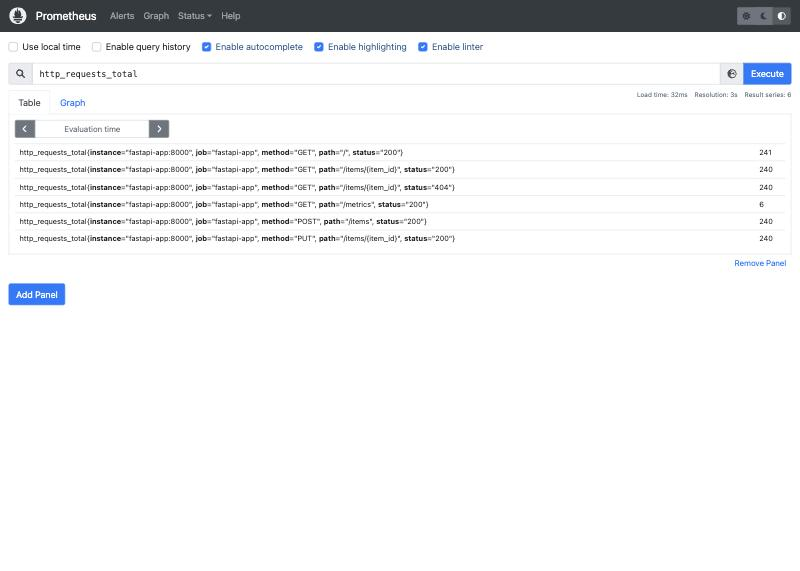
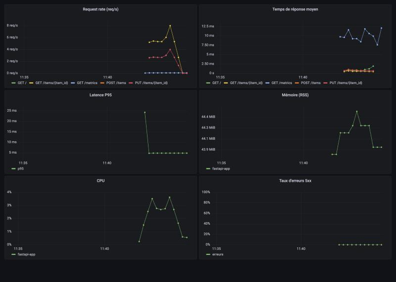

# Rapport : rendu du TP6

Stack lancée sur macOS avec Podman 6.1 et `podman-compose`, puis environ deux minutes de trafic généré avec une boucle curl.

## Lancement avec Podman

```bash
podman-compose up -d --build
```

## Trafic généré

```bash
for r in 1 2 3 4 5 6; do
  for i in $(seq 1 60); do
    curl -s -X POST localhost:8000/items -H "Content-Type: application/json" -d '{"name":"Test Item"}' >/dev/null
    curl -s localhost:8000/items/$i >/dev/null
    curl -s -X PUT localhost:8000/items/$i -H "Content-Type: application/json" -d '{"name":"Updated"}' >/dev/null
    curl -s localhost:8000/items/99999 >/dev/null  # 404
    curl -s localhost:8000/ >/dev/null
  done
  sleep 15
done
```

## Prometheus

Les deux targets (`fastapi-app` et `prometheus`) sont `up` dans Status > Targets. La requête `http_requests_total` renvoie six séries :



| Méthode | Path               | Status | Requêtes |
| ------- | ------------------ | ------ | -------- |
| GET     | `/`                | 200    | 361      |
| POST    | `/items`           | 200    | 360      |
| GET     | `/items/{item_id}` | 200    | 360      |
| GET     | `/items/{item_id}` | 404    | 360      |
| PUT     | `/items/{item_id}` | 200    | 360      |
| GET     | `/metrics`         | 200    | 13       |

Toutes les requêtes sur un item sont regroupées sous `/items/{item_id}`, ce qui confirme la correction de la normalisation des chemins. Avec le code d'origine, on aurait eu une série par id, soit plus de 700 ici.

## Requêtes du dashboard

| Panel                  | Requête PromQL |
| ---------------------- | -------------- |
| Request rate           | `sum(rate(http_requests_total[1m])) by (method, path)` |
| Temps de réponse moyen | `rate(http_request_duration_seconds_sum[1m]) / rate(http_request_duration_seconds_count[1m])` |
| Latence P95            | `histogram_quantile(0.95, sum(rate(http_request_duration_seconds_bucket[5m])) by (le))` |
| Mémoire                | `process_resident_memory_bytes{job="fastapi-app"}` |
| CPU                    | `rate(process_cpu_seconds_total{job="fastapi-app"}[1m]) * 100` |
| Taux d'erreurs 5xx     | `(sum(rate(http_requests_total{status=~"5.."}[1m])) or vector(0)) / sum(rate(http_requests_total[1m]))` |

Mémoire et CPU sont filtrés sur `job="fastapi-app"` parce que Prometheus expose lui aussi des métriques `process_*`. Sans filtre, les deux courbes se superposent.

L'API ne renvoie aucune 5xx en fonctionnement normal. Sans le `or vector(0)`, le numérateur n'a aucune série et Grafana affiche « No data » au lieu de 0. Les 404 sont des erreurs client et ne comptent pas.

## Grafana

La datasource et le dashboard « FastAPI Monitoring » étaient présents au premier login, sans configuration manuelle.



Ce qu'on y lit :

- Le request rate monte à 5 à 8 req/s sur `GET /items/{item_id}` (200 et 404 cumulés) et autour de 2,5 req/s sur chacune des autres routes, puis retombe à zéro à la fin de la boucle.
- Le temps de réponse moyen reste sous 1 ms pour les routes CRUD. `/metrics` tourne autour de 10 ms, le coût de la sérialisation de toutes les métriques par `generate_latest()`.
- Le P95 se stabilise vers 5 ms. Ce chiffre est grossier : le premier bucket de l'histogramme par défaut s'arrête à 5 ms, et `histogram_quantile` interpole à l'intérieur de ce bucket. Pour mesurer des latences sub-milliseconde, il faudrait déclarer des buckets plus fins.
- La mémoire reste stable autour de 44 Mio et le CPU plafonne à 3,5 % pendant la charge.
- Le taux d'erreurs 5xx reste à 0 %. Les 360 réponses 404 sont des erreurs client et ne rentrent pas dans ce calcul.

## Ajustements faits pendant le rendu

Le premier lancement a montré deux défauts dans le panel du taux d'erreurs, corrigés chacun dans un commit :

1. « No data » au lieu de 0. Sans aucune 5xx, la série du numérateur n'existe pas et la division ne renvoie rien. Corrigé avec `or vector(0)`.
2. Une fois le 0 affiché, Grafana choisissait une échelle jusqu'à 10000 %. L'axe est maintenant borné entre 0 et 100 %.

## Écarts avec les consignes

- Le code fourni normalisait les chemins avec `match.name == "match"`. Starlette renvoie `Match.FULL`, la condition n'était donc jamais vraie et chaque id créait son propre label (`/items/1`, `/items/2`…). C'est corrigé en comparant à `"FULL"`.
- `GET /items/{id}` renvoie une vraie 404 au lieu d'un 200 avec `{"error": ...}`, sinon les métriques comptent un succès.
- Le compose build l'API depuis le Dockerfile du dépôt au lieu de tirer l'image `rhosrow/fastapi:latest`.

## Questions de réflexion

**1. Pourquoi utiliser `rate()` pour les counters ?**

Un counter ne fait que monter depuis le démarrage du process. Sa valeur brute dit combien de requêtes ont été servies depuis le lancement, ce qui n'aide pas à savoir ce qui se passe maintenant. `rate()` calcule la vitesse d'augmentation par seconde sur la fenêtre choisie, et gère les remises à zéro quand le conteneur redémarre.

**2. Quelle est la différence entre moyenne et P95 ?**

La moyenne additionne toutes les durées et divise par le nombre de requêtes. Le P95 est la durée sous laquelle se trouvent 95 % des requêtes. Avec 95 requêtes à 10 ms et 5 à 2 s, la moyenne tombe à environ 110 ms, alors que 5 % des utilisateurs attendent 2 secondes.

**3. Pourquoi le P95 est-il plus important en production ?**

La moyenne lisse les requêtes lentes et peut rester correcte pendant qu'une partie des utilisateurs subit des temps de réponse mauvais. Le P95 montre ce que vivent les cas lents, c'est donc lui qu'on surveille et sur lequel on fixe les SLO et les alertes. Sur un service très sollicité, 5 % représente beaucoup de monde.

**4. Pourquoi diviser `_sum` par `_count` pour la moyenne ?**

L'histogramme expose `_sum`, le total des durées observées, et `_count`, le nombre d'observations. Le total divisé par le nombre donne la durée moyenne. On applique `rate()` aux deux avant de diviser pour obtenir la moyenne sur la dernière minute plutôt que depuis le démarrage.
